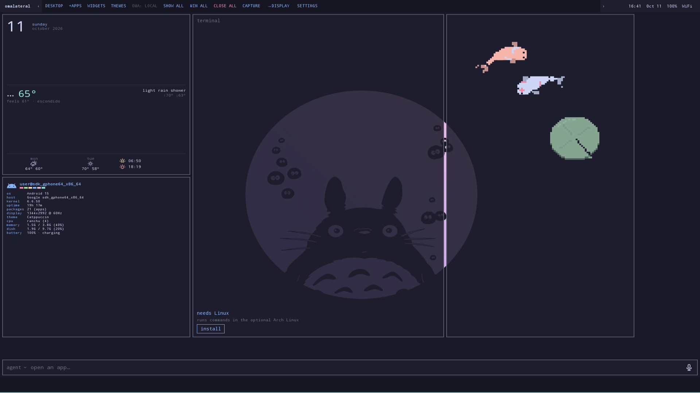
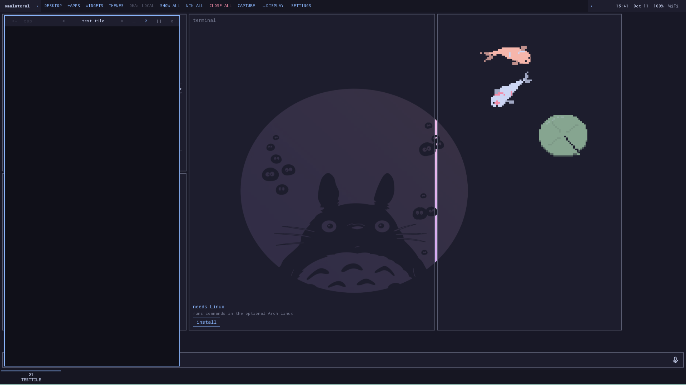
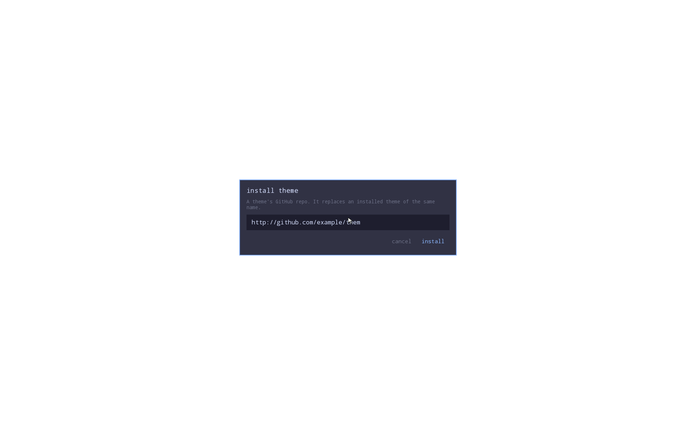

# omalateral — Omalauncher on your external desktop

Independent Android app (`com.omalateral`) combining LATERAL main's BeastUI
workspace with the real Omalauncher launcher, OWL widgets, widget store, and
Omarchy themes. Installs beside both original apps. See [UPSTREAMS.md](UPSTREAMS.md)
for exact source revisions and attribution.

Download testing APKs from [omalateral releases](https://github.com/cbarland/omalateral/releases).
The alpha APK is the ARM64, SDK-free `stableDebug` build: test-signed and
debuggable, not a production-hardened release. It installs beside LATERAL and
standalone Omalauncher. Do not uninstall an existing omalateral alpha to update it.

The external display opens the embedded Omalauncher home by default, with
Android app tiles above it. **OMA: LOCAL** identifies the active local runtime.
Widgets, themes, settings and any optional Linux installation belong to
`com.omalateral`; an existing standalone Omalauncher installation is unchanged.
Starting the desktop does not automatically install a Linux distribution.

Bridge preparation includes standalone Omalauncher detection on startup/resume
and package changes, a desktop-session interface, and lazy provider selection
that can prefer an authorized external session without starting a local runtime.
The external adapter is deliberately unavailable until a protocol is agreed and
implemented in both apps. **This alpha does not connect to stock Omalauncher or
share its data.** With no bridge, it always uses its own embedded desktop.
See the [upstream proposal](https://github.com/SimonSchubert/omalauncher/issues/34).

[Screenshots](#screenshots) · [Getting started](#getting-started) ·
[How to use](#how-to-use) · [Limitations](#current-limitations) ·
[Build from source](#build-omalateral-from-source)

## Screenshots

Actual captures from the alpha06 Android 15 emulator validation, using the
Catppuccin theme and an external display. These are not mockups or evidence of
compatibility with every physical phone/display.

### Home and widgets

The embedded Omalauncher home stays behind the workspace: calendar/weather,
system information, optional terminal, and animated OWL widgets.



<details>
<summary>App-tile layering and the theme-install dialog</summary>

The window decorator and numbered taskbar sit above the home. The empty
**TEST TILE** below is a validation fixture, not a running third-party app.



The pointer stays above the theme-install dialog. This is a capture of the
dialog's own window; the black area is not the composed desktop. Text is entered
using the phone keyboard, which is on the other display and is not pictured.
The example URL is test input, not a theme recommendation.



</details>

## Getting started

1. Download the ARM64 APK from [omalateral releases](https://github.com/cbarland/omalateral/releases)
   and install it on your phone. Allow installation from your browser/file manager
   if Android asks. To update, install over the existing omalateral app without
   uninstalling it; this preserves your settings and local runtime.
2. Connect an external monitor or glasses through a video-capable connection,
   then open **omalateral** on the phone. PhoneUI is the controller;
   BeastUI is the external desktop. The SDK-free APK does not include VITURE-only
   timing controls.
3. To host Android apps, activate the privileged helper. Tap the **display/status
   text in PhoneUI's top row**, then **Privileged helper** (the config dialog still
   carries the inherited `LATERAL_ / config` title).

   - **Shizuku:** start Shizuku v13+ in ADB/shell mode, select it in the helper
     panel, authorize **omalateral**, and wait for the connected state. Root mode
     is not supported. Restart Shizuku after a phone reboot.
   - **Wireless ADB:** select this backend and follow the pairing flow using
     Android Developer options → Wireless debugging → Pair device with pairing
     code. Submit the code through the app's pairing notification.
   - The inherited [helper guide](docs/SHIZUKU.md) explains setup and recovery;
     authorize **omalateral**, not a separate LATERAL installation.

4. Use **+APPS** on the external top bar, or **apps** on PhoneUI, to launch an
   Android app into the workspace. Use **DESKTOP** to minimize the app tiles and
   return to the home/widgets; select a numbered task tab to return to an app.

You do **not** need standalone Omalauncher or a Linux installation to start using
the embedded home. Features marked **needs Linux** are optional and experimental.
The inherited physical-hardware baseline is Nubia NX789J / Android 15 with VITURE
Beast; alpha06's final validation was on an Android API 35 emulator with an
external display. Other hardware is not guaranteed to work.

## How to use

### Pointer, scrolling, and typing

- Move your finger on PhoneUI's touchpad to move the external pointer; tap to click.
- For the home context menu, tap once, then **tap and hold the second tap**.
  A quick double-tap remains two clicks. Right-clicking empty desktop space opens
  the home menu; right-clicking a widget selects it for editing.
- USB/Bluetooth mouse input and Android-native mouse right-click are supported.
- Use the vertical scroll strip to scroll content under the pointer. The horizontal
  strip **below the touchpad, above the taskbar** pans the workspace sideways.
  Selecting/interacting with an app reveals it; panning alone does not change focus.
- Click an embedded Omalauncher text field, such as the theme-install URL field,
  to open the phone's software keyboard automatically. Input edits the external
  field directly. Use PhoneUI's close control, Back, or Escape to end typing.
  Hosted Android apps use the separate embedded FlorisBoard keyboard path.

### External top bar

| Control | Action |
| --- | --- |
| `DESKTOP` | Minimize app tiles and reveal the embedded home. |
| `+APPS` | Open the app drawer and launch apps into the workspace. |
| `WIDGETS` | Open Omalauncher's widget controls. |
| `THEMES` | Browse/select themes or open the theme-install dialog. Bundled themes synchronize with PhoneUI and BeastUI. |
| `OMA: LOCAL` | Show desktop connection status; the current runtime belongs to omalateral. |
| `SHOW ALL` / `MIN ALL` | Restore workspace apps / minimize them without closing their tasks. |
| `CLOSE ALL` | Close managed app tasks. Use this only when you intend to close them. |
| `CAPTURE` | Save the BeastUI window as a PNG in Gallery under `Pictures/LATERAL_`. |
| `→DISPLAY` | Open external-display information and display/profile controls. |
| `SETTINGS` | Open general input and appearance settings. |

The small arrows at the ends of the top-bar control group reveal controls that
do not fit. PhoneUI also has **disp** for display information/scaling and **set**
for general settings; **apps** opens a phone-side chooser for workspace apps.

### App tiles and taskbar

- Click a numbered task tab (`01`, `02`, …) to focus or restore that app.
  Taskbar edge arrows reveal tabs that are off-screen.
- In a tile's decorator, `<-` sends Back to the app; `<` and `>` beside its title
  move the tile left or right in the workspace order.
- `_` minimizes; `P` / `T` switches phone/tablet presentation; `[]` enters fullscreen.
  In fullscreen, use the **top-right `[P]` or `[T]` control** to return to the previous
  presentation rather than closing the app.
- `cap` captures the focused app surface without workspace chrome; `x` closes
  that Android task, not every instance of its package.
- The home stays mounted underneath app tiles. **DESKTOP** reveals it, while
  **WIDGETS**, **THEMES**, and **+APPS** open their panels above the tiles.

### If something does not work

- **No external desktop:** check that Android detects the external display;
  PhoneUI → **disp** shows its name, resolution, and refresh rate, or a no-display state.
- **Apps will not open / input stops:** check the helper connection from the
  PhoneUI status text → **Privileged helper**. Use **Restart helper** after an
  update if needed; Shizuku must be restarted after reboot.
- **A text field does not bring up the phone keyboard:** finish or dismiss any
  PhoneUI setup dialog, then select the external field again.
- **Looking for existing Omalauncher widgets or Linux setup:** this alpha has
  its own runtime. `OMA: LOCAL` does not mean it is connected to stock Omalauncher.

## Current limitations

This is an integration alpha. The optional Arch/PRoot code and pinned runtime
are included, but installing Linux and hosting its separate window activities
alongside Android tasks are not yet validated. Shared app data is not automatic:
Omalauncher and omalateral have separate Android sandboxes. Existing OWL source
and marketplace formats are retained; account/secret and full-home migration
remain separate work. Built-in themes synchronize with Beast/PhoneUI; arbitrary
community palette synchronization still needs extending.

The alpha APK remains test-signed and debuggable. The public external-desktop
bridge is a proposal, not an available connection to standalone Omalauncher.

## Build omalateral from source

On Windows, configure the Android SDK/JDK and native build prerequisites in the
inherited [installation guide](docs/INSTALLATION.md), then run:

```powershell
git submodule update --init
./scripts/fetch-oma-proot.ps1
./gradlew.bat :app:assembleStableDebug :owl:testDebugUnitTest -Plateral.vitureSdk=false
```

The APK is `app/build/outputs/apk/stable/debug/app-stable-debug.apk`.
Install or update without clearing data using `adb install -r <apk-path>`.

The original LATERAL documentation below describes the inherited workspace
engine and its hardware requirements; its release links refer to LATERAL.

<details>
<summary>Inherited LATERAL reference: architecture, hardware, builds, and troubleshooting</summary>

## Inherited LATERAL documentation

LATERAL_ is a device-specific dual-display workspace for a Nubia NX789J phone and VITURE Beast glasses. It keeps a purpose-built **PhoneUI** on the phone and a pinned **BeastUI** workspace on the glasses, while treating Android task IDs as the identity of the apps being managed.

## Watch the tutorial

[](https://www.youtube.com/watch?v=iaHQASn_Buw)

**[Watch the LATERAL_ tutorial on YouTube →](https://www.youtube.com/watch?v=iaHQASn_Buw)**

Architecture status: the v0.2 design invariants are canonicalized in the
[architecture charter](docs/ARCHITECTURE_CHARTER.md). The conservative
[Termux/Box64 Gradle worker contract](termux/README.md) is documented for
delegated builds; it is not wired into the Android app yet.

This is an experimental Android project for the target hardware, not a general-purpose external-display launcher.

## Intended use and tested hardware

LATERAL_ is an experimental personal dual-display workspace. PhoneUI stays on the
phone while BeastUI runs on the external display; hosting third-party apps requires
the privileged Wireless debugging pairing flow.

It has been tested only with a **Nubia NX789J running Android 15** and **VITURE
Beast glasses** connected as an external display. Other phones, Android versions,
external displays, and firmware revisions are unsupported and untested. Phone-only
keyboard routing, cursor/input injection, hosted apps, and display-mode controls
depend on the phone firmware, so re-test the privileged path after system updates.

## What it does

- **Display profiles** remember phone/tablet aspect ratios, supersampling, UI + text scale and hosted-app scale separately for each display and resolution. All controls live in Display. See [profile behavior and validation](docs/DISPLAY_PROFILES.md).
- **PhoneView** runs BeastUI fullscreen in landscape on the phone with an external keyboard and native Android mouse input. Enable it in Display settings when no external display is connected. Keyboard removal or display connection automatically restores traditional mode. See [PhoneView behavior and validation](docs/PHONEVIEW.md).
- **PhoneUI** provides the touchpad, cursor, app launcher, task navigator, scale controls, and input settings.
- **BeastUI** is an ordered horizontal workspace for apps on the glasses, with task decorators, taskbar tabs, minimization, fullscreen, screenshots, and a launcher overlay.
- Android tasks are continuously synchronized into one shared workspace model. Phone-launched apps stay on the phone and appear as entries in BeastUI; apps launched from LATERAL_'s launcher can be hosted on Beast.
- Multiple instances of an app remain separate because they are tracked by Android task ID, not package name.
- Closing an app with the Beast `×` control removes that exact Android task from Overview/open tasks; it does not force-stop the whole package.
- LATERAL_ keeps one PhoneUI task and one hidden, pinned BeastUI task. The Beast task is excluded from Android Overview.

## Important platform behavior

Hosting third-party apps on Beast relies on a shell-privileged helper activated through [Shizuku or Wireless ADB](docs/SHIZUKU.md). The helper creates trusted virtual displays, moves individual Android tasks, injects pointer/gesture input, and manages display lifecycle.

For native text editing, LATERAL_ temporarily selects its embedded FlorisBoard
session IME. The hosted editor keeps its real `InputConnection` and focus while
the keyboard itself is rendered at the bottom of PhoneUI. Android's IME window is
never shown on either display. The prior system keyboard is restored with
compare-and-set semantics when the session ends, including helper/Binder failure
recovery.

LATERAL_ prepares the hidden PhoneUI keyboard view without pre-binding Android's
IME service. Android initializes FlorisBoard exactly once when a verified hosted
editor activates it; Gboard (or the user's chosen IME) remains selected until
then. Embedded keyboard key presses use FlorisBoard's built-in haptic-feedback
path. It respects Android's system haptics setting and vibrates the phone, not the
glasses or Beast touchpad.

Behavior therefore depends on the NX789J firmware, Android build, and the connected Beast display. Re-test the privileged path after phone or system updates.

### Stable debug validation

Every new LATERAL version must pass the [USB bootstrap focus/chrome emulator gate](docs/BEAST_UI.md#required-emulator-regression-gate)
before phone handoff: `scripts/validate-beast-usb-ui.ps1 -Serial emulator-5554`.
It checks PhoneUI focus and touch after ten app restores, taskbar and `+APPS`
interaction, explicit Home, and detached-helper cleanup. Hardware validation remains separate.

Run the stable debug unit tests and assemble both the app and its instrumentation APK before validating a release candidate:

```powershell
cmd.exe /d /c gradlew.bat :app:testStableDebugUnitTest :app:assembleStableDebug :app:assembleStableDebugAndroidTest --offline --console=plain
```

Run the USB helper lifecycle instrumentation on an Android 12 or newer emulator or device with `:app:connectedStableDebugAndroidTest`. The lifecycle suite starts the production `--usb-adb-bootstrap` entry point and checks that its detached owner remains alive after stdin EOF, then cleans up the owner explicitly. Hardware input and secondary-display focus behavior still require validation on the supported phone and glasses.

## Requirements

- Nubia NX789J running the supported Android 15 firmware.
- An external display for monitor mode; VITURE Beast glasses are supported by
  the optional SDK-backed variant.
- Shizuku v13+ running in shell mode and authorization, or Developer options and Wireless debugging for the ADB backend.
- Android Studio with JDK 17 and an Android SDK/NDK installation suitable for the project.
- Rust stable (minimal profile) and CMake 4.1.2 for FlorisBoard's arm64 native engine.
- ADB available when installing development builds.

## Build and install

The public stable APK is the SDK-free monitor build. It does not contain the
VITURE SDK, does not require a VITURE developer account, and keeps VITURE-only
display timing controls out of the app. Build it locally with:

```powershell
.\gradlew.bat :app:assembleStableRelease "-Plateral.vitureSdk=false"
```

### Optional VITURE variant

VITURE support is completely optional. Users who want the VITURE-specific
display timing and glasses controls should request access to the official VITURE
SDK from [VITURE's developer portal](https://www.viture.com/en-US/developer),
download it under VITURE's terms, and place its headers and ARM64 runtime in the
private `uxspace/Android/glasses/src/main/` layout described in the
[installation guide](docs/INSTALLATION.md). Do not commit or redistribute the
SDK files.

With that SDK present, build the separate green-logo `LATERAL_ (V)` variant:

```powershell
.\gradlew.bat :app:assembleVitureRelease "-Plateral.vitureSdk=true"
```

The VITURE variant intentionally fails at build time when the SDK is absent.
The regular public `stable` variant remains SDK-free when built with
`-Plateral.vitureSdk=false`.

See the complete [installation guide](docs/INSTALLATION.md) for public APK
installation, source builds, optional VITURE SDK setup, Wireless debugging
pairing, and troubleshooting.

From the repository root:

```powershell
git submodule update --init --recursive
.\gradlew.bat :app:assembleStableDebug "-Plateral.vitureSdk=false"
adb install -r app\build\outputs\apk\stable\debug\app-stable-debug.apk
```

On macOS/Linux, use:

```bash
git submodule update --init --recursive
./gradlew :app:assembleStableDebug "-Plateral.vitureSdk=false"
adb install -r app/build/outputs/apk/stable/debug/app-stable-debug.apk
```

## First-use flow

1. Connect the Beast glasses.
2. Launch LATERAL_ from the phone.
3. In PhoneUI configuration, select **Privileged helper**. Authorize Shizuku or pair Wireless ADB on the phone.
4. Open **Apps** to show the Beast launcher, or select an existing Android task in the shared navigator.
5. Use the PhoneUI touchpad to control the glasses workspace.

Normal Android app launches remain phone-hosted. They are imported into the Beast task list shortly afterward, where selecting one can move that exact task into the Beast workspace when it supports secondary-display hosting.

## Input and workspace controls

- One-finger motion moves the Beast cursor; tap performs a normal click.
- A deliberate hold supports drag/long-press behavior; multi-touch transition guards prevent ordinary taps from becoming long presses.
- Two-finger movement scrolls the app under the cursor first, then the Beast workspace if no app consumes it.
- Edge/taskbar scrolling moves the Beast workspace. Two-finger and scrollbar directions have independent inversion toggles.
- Pinch gestures are forwarded as a two-pointer gesture to hosted apps where supported.
- Beast focus changes do not reorder the strip. LATERAL_ only scrolls enough to reveal a focused card that is partly or completely off-screen.

Task presentation is intentionally semantic rather than freeform: `PHONE`, `BEAST_VISIBLE`, `BEAST_MINIMIZED`, and pending-hosting states, plus phone/tablet/fullscreen presentation modes. There is no drag-resize window manager.

## Scaling and Ultrawide

PhoneUI and BeastUI use one locked UI-and-text scale per display mode:

- Standard: 85–200%
- Ultrawide: 85–500%

Ultrawide mode is detected from the connected display. LATERAL_ corrects for the display's horizontal presentation characteristics and sizes app cards from the available vertical app-content height after scaled decorator chrome, so apps reflow rather than being compositor-stretched.

## Project map

- `app/src/main/java/com/lateral/MainActivity.kt` — PhoneUI and phone-side controls.
- `app/src/main/java/com/lateral/beast/BeastActivity.kt` — Beast workspace shell.
- `app/src/main/java/com/lateral/beast/WorkspaceState.kt` — shared task/workspace state.
- `app/src/main/java/com/lateral/beast/AndroidTaskSynchronizer.kt` — Android task snapshot reconciliation.
- `app/src/main/java/com/lateral/privileged/` — shell helper, trusted displays, task operations, and input injection.
- `third_party/florisboard/` — pinned FlorisBoard v0.5.2 fork and isolated `:embedded` library.
- `docs/FLORISBOARD_EMBEDDED.md` — embedded-IME architecture and upstream upgrade workflow.
- `docs/BEAST_UI.md` — BeastUI architecture and invariants.
- `docs/ARCHITECTURE_CHARTER.md` — canonical shared-state, UI, lifecycle, and phased implementation contract.
- `termux/README.md` — Termux/Box64 Gradle worker contract, safe worker usage, and fake-worker tests.
- `LATERAL_ Outline.md` — product/design reference.
- `docs/ROADMAP.md` — planned SDK-free monitor release and future work.

## Troubleshooting

- **Embedded keyboard unavailable**: re-pair/restart the privileged helper. LATERAL_
  will leave the hosted editor focused and restore the previous keyboard instead of
  falling back to shell text injection.
- **No keyboard haptics**: enable Android system haptics. The embedded FlorisBoard
  key-press feedback respects that global preference.
- **Black hosted app surface**: reconnect the glasses or restore/minimize the card to trigger surface reattachment. The implementation uses `TextureView` composition because the target device can render nested `SurfaceView` virtual-display queues as black.
- **External display changed mode**: allow LATERAL_ to reconfigure the workspace; it preserves the workspace model and reattaches hosted surfaces where the firmware allows it.
- **Unexpected task state**: Android Overview remains authoritative for task existence. LATERAL_ reconciles task snapshots while Beast is connected, while avoiding system, Home, LATERAL_, and known device ghost records.

</details>

## License and attribution

This is an independent integration, not an official Omalauncher or Omarchy release.
See [UPSTREAMS.md](UPSTREAMS.md) for provenance and integration changes.
The Omalauncher component retains its [MIT license](third_party/omalauncher/LICENSE).

LATERAL_-specific code is licensed under [Apache-2.0](LICENSE). See
[NOTICE](NOTICE), [`LICENSE-UXSPACE`](LICENSE-UXSPACE), and
[`third_party/florisboard/LICENSE`](third_party/florisboard/LICENSE) for retained
third-party attribution and license text. UxSpace is used as a reference for trusted per-app
virtual-display hosting; LATERAL_ deliberately does not reuse its freeform
drag/drop window-management model. FlorisBoard v0.5.2 supplies the embedded
session keyboard UI, layouts, editor engine, assets, and Snygg styling system.
