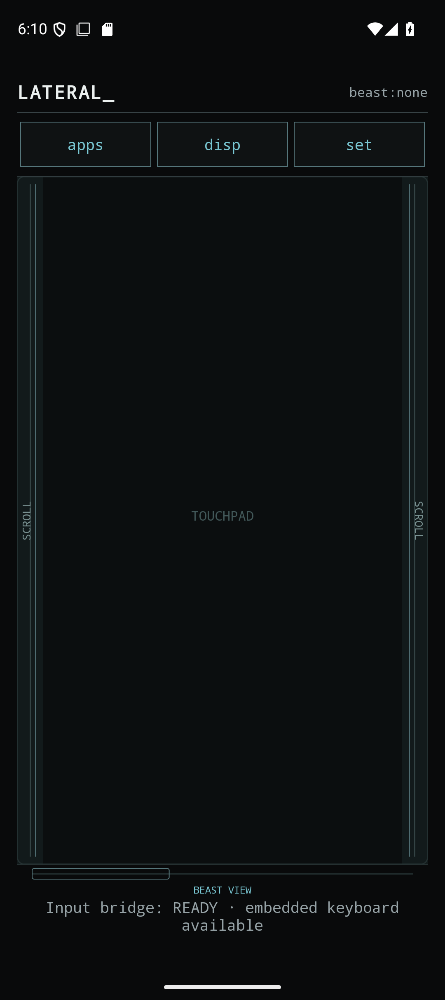
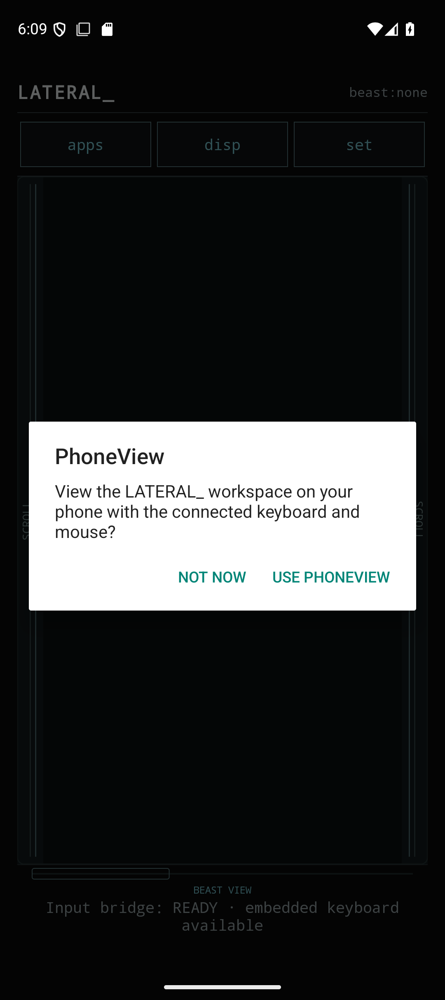
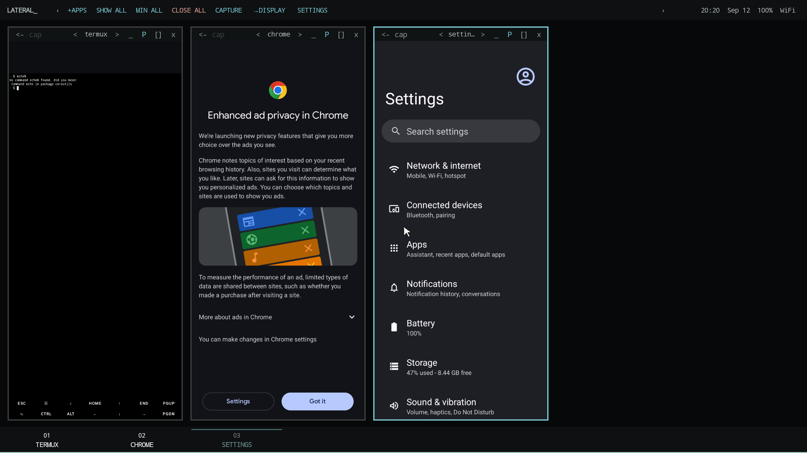
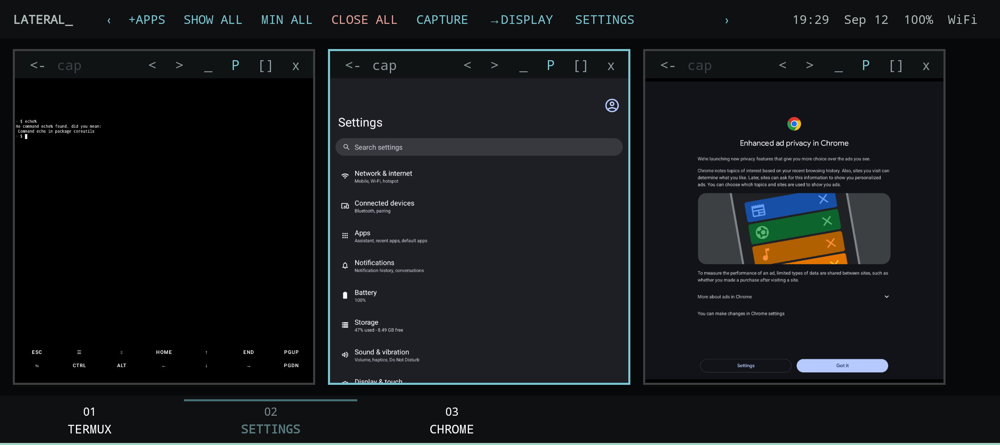
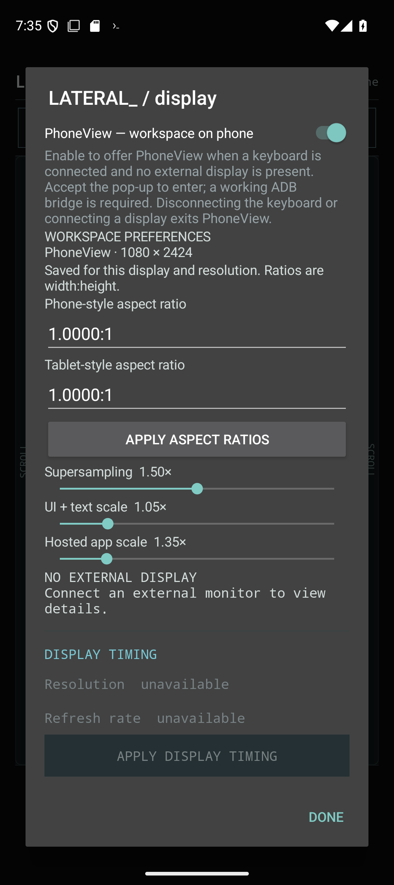

# LATERAL_ v0.3 — Your workspace, wherever the screen is

LATERAL_ began as a way to turn a pair of display glasses into a practical Android workspace. v0.3 brings that same workspace back to the device in your hand.

The headline feature is **PhoneView**: connect a keyboard, leave the external display unplugged, and LATERAL_ can place the complete BeastUI workspace on the phone itself. Turn the phone sideways, add a mouse, and the phone becomes a compact desktop without changing how your workspace is organized.

## A deliberate handoff

PhoneView is enabled from **Display** in either PhoneUI or BeastUI. Enabling it does not immediately take over the screen. When PhoneUI comes into focus, LATERAL_ checks three things:

- an external keyboard is connected;
- no external display is connected; and
- the ADB input bridge is ready.

When those conditions are met, LATERAL_ asks before changing modes.

Accepting the prompt opens BeastUI full-screen in landscape and hands pointer and keyboard input back to Android. Mouse clicks are native, touch remains touch, and Android Home and Recents remain available. Disconnect the keyboard or plug in an external display and LATERAL_ automatically leaves PhoneView. Connect glasses or a monitor and the familiar split returns: PhoneUI stays on the phone while BeastUI moves to the external display.

For keyboard-only navigation, `Ctrl+Left` and `Ctrl+Right` jump focus to the adjacent workspace window and scroll it into view in both PhoneView and external BeastUI.

On larger displays, the decorator now scales as one centered unit so app titles remain visible alongside every control. The workspace pointer has also been redrawn as a compact off-white arrow with a charcoal keyline—crisp against dark surfaces without borrowing the interface accent color.

## BeastUI now fits in your pocket

PhoneView is not a reduced remote control. It is the same workspace, with hosted apps, window controls, capture tools, display controls, and settings. Here, Termux, Android Settings, and Chrome are all rendering side by side in dark mode with a 1.35× hosted-app scale.

The narrow-screen pass in v0.3 also makes the window decorators genuinely usable on a phone. All eight controls fit without falling off the card, centered controls remain centered, and the entire top ribbon responds to an external mouse—not only the Settings button. Primary and secondary click handling, touch conversion, modifier keys, key-up events, and focus recovery have all been tightened up along the way.

## Every display gets its own workspace profile

The display controls have moved out of general Settings and into **Display**, where their effect is easier to understand. LATERAL_ now saves them against the display identity and active resolution. PhoneView, standard Beast glasses, and the same glasses in ultrawide mode can therefore keep different preferences without constantly being readjusted.

Each profile includes:

- separate preferred aspect ratios for phone-style and tablet-style apps;
- supersampling from 1× to 2×;
- UI and text scale; and
- hosted-app scale from 0.6× to 5×.

New PhoneView profiles start at **1.5× supersampling**. This gives Android apps a healthier internal canvas before LATERAL_ scales them into a window, which is especially helpful for system apps that assume a minimum layout size. Existing user choices are preserved, and the controls remain global within each display profile so users can tune the balance that works best for their app mix.

## A quieter, sturdier release

v0.3 includes the display polish and bug fixes developed alongside PhoneView: safer scale ranges and reload handling, corrected app aspect ratios, persistent display profiles, improved external-display handoff, and resilient focus behavior. Agent controls are intentionally absent from main and remain isolated on `LATERAL_dev` until that work is ready for users.

The v0.3 walkthrough was exercised on the Redmagic Android 15 emulator with a simulated external keyboard, native mouse injection, the embedded ADB bridge, and a 2560 × 1440 external display. The tested path covered PhoneUI resume detection, the opt-in prompt, PhoneView entry, mouse-operated ribbon and decorators, and automatic handoff back to external BeastUI.
